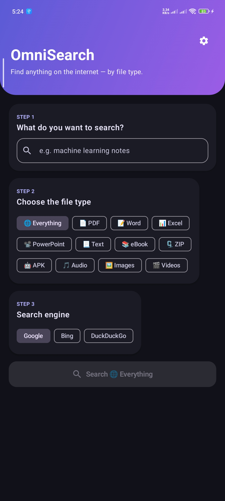
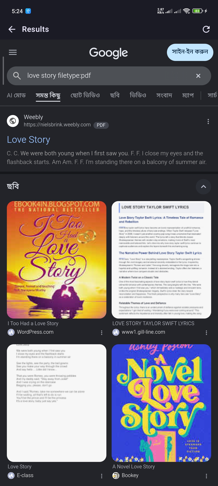
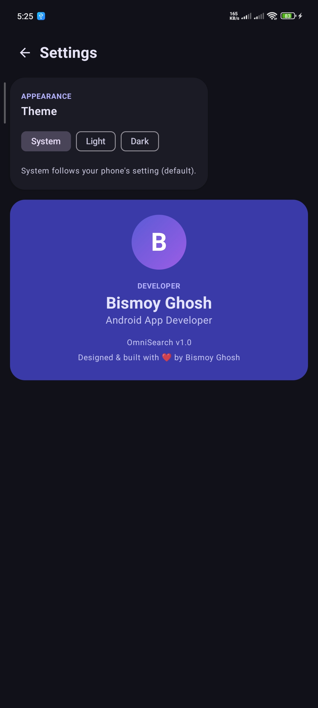

# 🔎 OmniSearch

**Find anything on the internet — by file type.**

## ⬇️ Download

**[Download OmniSearch-v1.0.0.apk](releases/Omni-Search-v1.0.0.apk)**

### How to install
1. Download the APK on your Android phone.
2. Open it. If asked, allow **Install unknown apps** for your browser or file manager.
3. Tap **Install**, then open **OmniSearch**.

Requires Android 7.0 or newer.

## ✨ Features
- Guided search: what to search → file type → search engine
- 12 file types: Everything, PDF, Word, Excel, PowerPoint, Text, eBook, ZIP, APK, Audio, Images, Videos
- Google, Bing and DuckDuckGo
- Built-in browser with one-tap downloads
- Light, Dark and System (default) themes
- Modern Material 3 design

## 📸 Screenshots
| Home | Results | Settings |
|------|---------|----------|
|  |  |  |

## ⚠️ Disclaimer
OmniSearch only opens public search-engine results. You are responsible for what you download. Respect copyright and your local laws.

## 👨‍💻 Developer
**Bismoy Ghosh** – Android App Developer

## 📄 License
[MIT](LICENSE)
